 

## About

I'm a software engineer who builds **backend-first systems**: scalable APIs, multi-tenant SaaS and event-driven services in **Java, Spring Boot, Python and Node.js**, backed by **PostgreSQL and Redis**, and shipped on **AWS with Docker and CI/CD**. Alongside that I build **LLM agent systems** with LangGraph, tool calling and retrieval, plus the guardrails that make them safe to run in production.

- **Now:** Software Engineer at **BTG**, building Stripe billing, referral commissions and bank-deposit matching
- **Shipped:** [SheOut](https://www.sheoutride.com/), a women-only ride, parcel and marketplace platform live in Hyderabad
- **Recently:** built FactoryFlow AI end to end in 24 hours at **Buildathon Dallas 2026**
- **Education:** M.S. Computer Science, University of Central Missouri (2026, GPA 3.60)
- **Based in** Dallas, TX · open to relocation

## Experience

<table>
<tr>
<td width="190" valign="top">
<b>AUG 2026 to PRESENT</b> 
Remote
</td>
<td valign="top">
<b>Software Engineer</b> · BTG
<ul>
<li>Built <b>Stripe Checkout and Customer Portal billing infrastructure</b>: subscription and invoice projections, dunning, recovery, cancellation, idempotent checkout and typed Stripe errors.</li>
<li>Designed a <b>referral commission system</b> with accrual on paid invoices, reversals for refunds and lost disputes, and scheduled qualification after 60 paid days.</li>
<li>Built <b>bank-deposit matching</b> for agent commissions using Stripe Financial Connections, with race-safe deposit confirmation and opt-in auto-confirmation.</li>
</ul>
</td>
</tr>
<tr>
<td width="190" valign="top">
<b>SEP 2025 to JAN 2026</b> 
Overland Park, KS
</td>
<td valign="top">
<b>Software Engineer Intern, Backend Engineering</b> · Jio Robotics
<ul>
<li><b>Cut API latency by 25%</b> through PostgreSQL query profiling, execution-plan analysis and query-path optimization.</li>
<li>Developed backend services and internal REST APIs for operational workflows; contributed to troubleshooting, peer code reviews, testing and CI/CD deployments.</li>
<li>Partnered with stakeholders in Agile sprints to turn requirements into maintainable backend services and feature releases.</li>
</ul>
</td>
</tr>
<tr>
<td width="190" valign="top">
<b>AUG 2023 to JUN 2024</b> 
Hyderabad, India
</td>
<td valign="top">
<b>Research Analyst, Embedded Systems &amp; Signal Processing</b> · Central Institute of Tool Design
<ul>
<li>Built an Arduino-based object detection and distance-measurement system using ultrasonic sensors and time-of-flight signal processing.</li>
<li>Developed Python visualizations and ran sensor calibration to analyze reliability and measurement consistency.</li>
</ul>
</td>
</tr>
<tr>
<td width="190" valign="top">
<b>AUG 2024 to MAY 2026</b> 
Lee's Summit, MO
</td>
<td valign="top">
<b>M.S. Computer Science</b> · University of Central Missouri · GPA 3.60
<ul>
<li>Data Structures · Algorithms · Machine Learning · Distributed Systems · Computer Architecture · Software Engineering · Network Security · Operating Systems</li>
</ul>
</td>
</tr>
</table>

## Featured systems

<a href="https://www.sheoutride.com/">Website</a> · <a href="https://app.sheoutride.com">Rider app</a> · <a href="https://partner.sheoutride.com">Partner app</a>

<table>
<tr>
<td width="50%" valign="top">

<a href="https://factoryflow-ai.vercel.app/">Live demo</a> · <a href="https://github.com/panakantinandu/factoryflow-ai">Source</a>

</td>
<td width="50%" valign="top">

<a href="https://mcpsentinel.vercel.app">Live console</a> · <a href="https://github.com/panakantinandu/MCPSentinel">Source</a>

</td>
</tr>
<tr>
<td width="50%" valign="top">

<a href="https://github.com/panakantinandu/DevArena">Source</a>

</td>
<td width="50%" valign="top">

<a href="https://propmind-6mkn.onrender.com">Admin demo</a> · <a href="https://propmind-tenant.onrender.com">Tenant demo</a> · <a href="https://github.com/panakantinandu/PropMind">Source</a>

</td>
</tr>
<tr>
<td width="50%" valign="top">

<a href="https://raki-frontend.vercel.app/">Live demo</a> · <a href="https://github.com/panakantinandu/raki-ca-platform">Source</a>

</td>
<td width="50%" valign="top">

<a href="https://ai-saas-copilot.vercel.app/">Live demo</a> · <a href="https://github.com/panakantinandu/ai-saas-copilot">Source</a>

</td>
</tr>
</table>

<b>Engineering notes: what's under the hood</b>

 

**SheOut**: one Spring Boot 3 / Java 21 deployable, organized as a modular monolith.
- Each domain (auth, verification, booking, dispatch, payments, payouts, insurance) is a module with a public API and a private `internal` package; modules react to each other through in-process domain events.
- Ride and parcel booking, trip lifecycle and partner verification, with Redis geo search driving dispatch plus OTPs and rate limits.
- Two installable React PWAs for riders and partners in English, Hindi and Telugu; Razorpay checkout, webhooks and partner payouts; a staff console with two-person approval for money and access.

**FactoryFlow AI**: polyglot system. Spring Boot owns the REST surface, JPA entities and PostgreSQL; a Python FastAPI service owns all LangGraph reasoning, tool execution and LLM calls, behind versioned HTTP contracts.
- Conditional reasoning graph: high-confidence alarms take a fast path using validated prior fixes; low-confidence ones trigger retrieval, incident search and Tavily web search before diagnosis.
- Resolved incidents are persisted with a `times_reused` counter, so resolution speed improves as the knowledge base grows.
- Built solo in 24 hours at Buildathon Dallas 2026, from a 7-table normalized schema through deployment, CI/CD and a React UI streaming agent reasoning over SSE.

**MCPSentinel**: four independent, separately tested Python services for the parts of MCP/LLM infra that break in production.
- `mcp_server` validates tool input and never leaks stack traces; `mcp_proxy` blocks unauthorized callers from privileged `admin_*` tools.
- `llm_gateway` redacts PII *mid-stream*, before the full response exists; `llm_router` fails over between upstreams and isolates runaway tenants.
- A live console drives the real services, so a denial, a redaction or a failover happens in front of you, not against a mock.

**DevArena**: modular monolith (Java 21, Spring Boot 4.1, React 19, PostgreSQL).
- Server-authoritative multiplayer: timers, scoring and answer validation run on the server under a per-battle lock inside DB transactions.
- Unique constraints make duplicate XP, duplicate answers and double mission completions impossible, even under concurrency.
- HttpOnly session cookies through a same-origin proxy; WebSockets authenticate with short-lived single-use tickets. No paid AI APIs: every score is deterministic and explainable.

**PropMind**: multi-tenant SaaS with separate admin and tenant portals over a shared service layer.
- Stripe Checkout with signature-verified, idempotent webhooks and a double-entry ledger, so every transaction is traceable and replay-safe.
- BullMQ/Redis jobs handle invoices, late fees, deposit expiry and rent reminders; Socket.io pushes real-time notifications.
- Three production LLM features: tenant risk scoring, maintenance triage with priority classification, and a natural-language assistant over live records.

**Raki**: multi-tenant SaaS for CA firms (Java 17, Spring Boot 3, React).
- Strict tenant isolation across 15+ REST endpoints: Spring Security, JWT and Google OAuth2, account-scoped queries, Redis/Bucket4j rate limiting.
- The Claude API extracts structured fields from unstructured invoices, cutting repetitive data entry on recurring filings.
- Containerized, horizontally scalable deployment with managed PostgreSQL (Flyway) and Redis.

**SaaS Ops Copilot**: FastAPI, SQLAlchemy and PostgreSQL behind GitHub OAuth (one-time code exchange, then an HttpOnly cookie).
- Modular analytics flag dormant repos, security exposure and CI/CD spend; an LLM writes per-repo remediation plans.
- A conversational copilot answers natural-language questions over live engineering data.

### More builds

| Project | What it does | Stack | Links |
|---|---|---|---|
| **AI Workflow Platform** | Incident-response pipeline: async workers run LLM log analysis, then an evaluator scores each output out of 100 and rejects weak ones. | FastAPI · PostgreSQL · React · Prometheus | [Live](https://ai-workflow-platform-sigma.vercel.app/) · [Source](https://github.com/panakantinandu/ai-workflow-platform) |
| **Draftly** | Document workspace with owner/editor/viewer sharing, revision-checked autosave (stale writes get a 409), and safe Markdown import. | Next.js · Prisma · PostgreSQL · Tiptap · Zod | [Live](https://collaborative-editor-neon-alpha.vercel.app) · [Source](https://github.com/panakantinandu/Collaborative_Editor) |
| **Colony Connect** | Civic issue tracker for a residential colony: residents report, a volunteer counsellor triages and escalates to the municipality. | Spring Boot · JWT · React · Leaflet | [Live](https://colony-connect.vercel.app) · [Source](https://github.com/panakantinandu/ColonyConnect) |
| **Identity Drift Detection** | Catches post-compromise IAM privilege escalation with daily snapshot diffing plus real-time CloudTrail rules and risk-scored alerts. | Lambda · EventBridge · CloudTrail · DynamoDB | [Source](https://github.com/panakantinandu/identity-drift-detection) |
| **SafeVault** | ASP.NET Core app hardened against SQLi, XSS and broken access control: parameterized queries, PBKDF2, JWT with RBAC, attack-simulation tests. | C# · ASP.NET Core · JWT | [Source](https://github.com/panakantinandu/SafeVault) |
| **Attrition Predictor** | Explainable ML: SHAP per-prediction attributions, SMOTE balancing, and a Streamlit app for batch CSV scoring. | scikit-learn · SHAP · Streamlit | [Live](https://ml-project-nan.onrender.com/) · [Source](https://github.com/panakantinandu/employee-attrition-predictor) |
| **LeaseHub** | Property SaaS with admin and tenant portals, Stripe, automated rent cycles and late fees, plus audit logs. | Node.js · MongoDB · Stripe · Docker | [Live](https://leasehub-admin.onrender.com) · [Source](https://github.com/panakantinandu/leasehub) |

Demos hosted on Render's free tier can take about 30 seconds to wake up.

## Stack

<table>
<tr>
<td width="150"><b>LANGUAGES</b></td>
<td></td>
</tr>
<tr>
<td><b>BACKEND</b></td>
<td></td>
</tr>
<tr>
<td><b>AI &amp; LLM</b></td>
<td>

</td>
</tr>
<tr>
<td><b>DATA</b></td>
<td></td>
</tr>
<tr>
<td><b>CLOUD &amp; OPS</b></td>
<td></td>
</tr>
<tr>
<td><b>FRONTEND &amp; ML</b></td>
<td></td>
</tr>
</table>

## How I build

| Principle | In practice |
|---|---|
| **Rules live in code, not in people** | Dunning, commission qualification, deposit expiry, tenant isolation and filing deadlines are enforced by schedulers, constraints and policies, not reminders. |
| **Every money path is replayable** | Signature-verified, idempotent webhooks and race-safe confirmations write to a ledger, so a retried event can never double-charge or double-pay. |
| **AI ships with guardrails** | Confidence routing, evaluator passes that reject weak outputs, schema validation, tool-level authz and streaming PII redaction. |
| **The server is the source of truth** | Timers, scores, fares and permissions are decided server-side and backed by database constraints that hold under concurrency. |
| **Failures should be traceable** | Retries with persistent job state, metrics and audit logs, so "what happened?" has an answer. |

## Credentials

<b>Achievement:</b> Buildathon Dallas 2026, built and deployed FactoryFlow AI end to end in a 24-hour engineering event.

## Activity

<picture>
  <source media="(prefers-color-scheme: dark)" srcset="https://raw.githubusercontent.com/panakantinandu/panakantinandu/output/snake-dark.svg" />
  
</picture>

 

